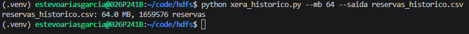
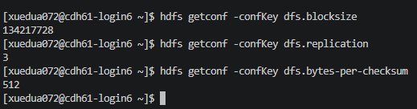
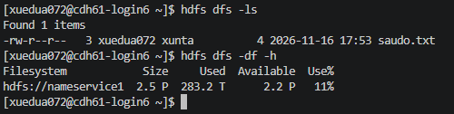
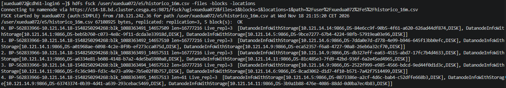
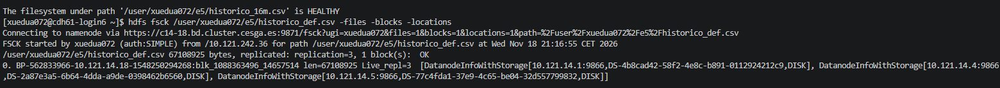
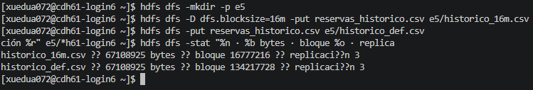

# E5. Integridade dos datos en HDFS

## 1. Xeración do histórico de reservas

Para realizar esta práctica utilizouse o script `xera_historico.py`, descargado de Moodle. Este script permite xerar un ficheiro CSV co histórico de reservas, indicando o tamaño desexado en MB.

Executouse o seguinte comando para xerar un ficheiro de 64 MB:

```bash
python xera_historico.py --mb 64 --saida reservas_historico.csv
```

O ficheiro xerado será utilizado nas seguintes probas para analizar como HDFS almacena os datos, os divide en bloques e mantén as súas réplicas.

**Captura 1. Xeración do ficheiro CSV**



---

## 2. C1. A contorna

Neste apartado consultouse a configuración de HDFS para coñecer o tamaño dos bloques, o factor de replicación e o intervalo utilizado para calcular as sumas de verificación (*checksums*). Tamén se comprobou o cartafol persoal do usuario e a capacidade de almacenamento do clúster.

### 2.1. Configuración de HDFS

Para consultar os parámetros de configuración executáronse os seguintes comandos:

**Tamaño dos bloques:**

```bash
hdfs getconf -confKey dfs.blocksize
```

Saída:

```text
134217728
```

O tamaño de bloque é de **134.217.728 bytes**, que equivale a **128 MiB** (aproximadamente 134,22 MB decimais).

**Factor de replicación:**

```bash
hdfs getconf -confKey dfs.replication
```

Saída:

```text
3
```

O factor de replicación é **3**, polo que HDFS mantén tres copias de cada bloque, sempre que a distribución e o estado do clúster o permitan.

**Bytes por suma de verificación:**

```bash
hdfs getconf -confKey dfs.bytes-per-checksum
```

Saída:

```text
512
```

HDFS calcula unha suma de verificación por cada **512 bytes** de datos.

**Captura 2. Configuración de HDFS**



### 2.2. Cartafol persoal e capacidade do clúster

Para consultar o contido do cartafol persoal en HDFS executouse:

```bash
hdfs dfs -ls
```

Saída:

```text
Found 1 items
-rw-r--r--   3 xuedua072 xunta          4 2026-11-16 17:53 saudo.txt
```

O cartafol persoal de HDFS corresponde a:

```text
/user/xuedua072
```

Na saída obsérvase o ficheiro `saudo.txt`, cun tamaño de 4 bytes. O número `3` que aparece na saída indica que este ficheiro ten un factor de replicación de 3.

A continuación, consultouse a capacidade de almacenamento do sistema:

```bash
hdfs dfs -df -h
```

Saída:

```text
Filesystem            Size     Used  Available  Use%
hdfs://nameservice1  2.5 P  283.2 T      2.2 P   11%
```

Segundo os resultados, o clúster presenta os seguintes valores:

- **Capacidade total:** 2,5 PB.
- **Espazo ocupado:** 283,2 TB.
- **Espazo dispoñible:** 2,2 PB.
- **Porcentaxe de ocupación:** 11 %.

**Captura 3. Cartafol persoal e capacidade do clúster**



### 2.3. Respostas ás cuestións

**1. Cal é o tamaño de bloque, a replicación e cada cantos bytes se calcula unha suma de verificación?**

- Tamaño de bloque: 134.217.728 bytes, é dicir, 128 MiB.
- Factor de replicación: 3.
- Bytes por suma de verificación: 512 bytes.

**2. Cantas sumas de verificación ten un bloque completo?**

Para calcular o número de sumas de verificación dun bloque completo, divídese o tamaño do bloque entre os bytes utilizados para cada suma:

```text
134.217.728 / 512 = 262.144
```

Polo tanto, un bloque completo contén **262.144 sumas de verificación**.

**3. Cal é o teu cartafol persoal en HDFS? Canto espazo ten o clúster e canto está ocupado?**

O cartafol persoal do usuario é `/user/xuedua072`.

O clúster ten unha capacidade total de 2,5 PB, dos cales 283,2 TB están ocupados. Isto representa aproximadamente un 11 % da capacidade total.

---

*Fin

## 3. C2. Subir un ficheiro e ver os seus bloques

Neste apartado subiuse a HDFS o ficheiro `reservas_historico.csv` dúas veces, utilizando diferentes tamaños de bloque para comparar como HDFS divide e almacena os datos.

### 3.1. Creación do cartafol e subida dos ficheiros

En primeiro lugar, creouse o cartafol `e5` en HDFS:

```bash
hdfs dfs -mkdir -p e5
```

A continuación, subiuse o ficheiro cun tamaño de bloque de 16 MiB:

```bash
hdfs dfs -D dfs.blocksize=16m -put reservas_historico.csv e5/historico_16m.csv
```

Despois, subiuse unha segunda copia utilizando o tamaño de bloque predeterminado do clúster:

```bash
hdfs dfs -put reservas_historico.csv e5/historico_def.csv
```

Para comprobar as características dos dous ficheiros executouse:

```bash
hdfs dfs -stat "%n · %b bytes · bloque %o · replicación %r" e5/*
```

Saída:

```text
historico_16m.csv 67108925 bytes bloque 16777216 replicación 3
historico_def.csv 67108925 bytes bloque 134217728 replicación 3
```

Os dous ficheiros teñen o mesmo tamaño, 67.108.925 bytes, pero utilizan tamaños de bloque diferentes: 16 MiB e 128 MiB, respectivamente. Ambos teñen un factor de replicación de 3.

### 3.2. Consulta dos bloques e das súas localizacións

Para inspeccionar os bloques do primeiro ficheiro executouse:

```bash
hdfs fsck /user/xuedua072/e5/historico_16m.csv -files -blocks -locations
```

O resultado indica:

```text
Status: HEALTHY
Number of data-nodes: 14
Number of racks: 1

Total size: 67108925 B
Total files: 1
Total blocks (validated): 5

Minimally replicated blocks: 5 (100.0 %)
Over-replicated blocks: 0
Under-replicated blocks: 0
Mis-replicated blocks: 0

Default replication factor: 3
Average block replication: 3.0

Missing blocks: 0
Corrupt blocks: 0
Missing replicas: 0 (0.0 %)
```

O ficheiro ten 5 bloques: catro bloques completos de 16 MiB e un último bloque parcial.

Para inspeccionar o segundo ficheiro executouse:

```bash
hdfs fsck /user/xuedua072/e5/historico_def.csv -files -blocks -locations
```

O resultado indica:

```text
Status: HEALTHY
Number of data-nodes: 14
Number of racks: 1

Total size: 67108925 B
Total files: 1
Total blocks (validated): 1

Minimally replicated blocks: 1 (100.0 %)
Over-replicated blocks: 0
Under-replicated blocks: 0
Mis-replicated blocks: 0

Default replication factor: 3
Average block replication: 3.0

Missing blocks: 0
Corrupt blocks: 0
Missing replicas: 0 (0.0 %)
```

Neste caso, o ficheiro ocupa un único bloque parcial, xa que o seu tamaño é inferior ao tamaño de bloque predeterminado de 128 MiB.

Os dous ficheiros aparecen co estado `HEALTHY`. Ademais, todos os bloques teñen a replicación esperada de 3, sen bloques corruptos nin réplicas ausentes.

### 3.3. Consulta do espazo ocupado

Para comprobar canto espazo ocupan os ficheiros executouse:

```bash
hdfs dfs -du -h e5
```

Saída:

```text
64.0 M  192.0 M  e5/historico_16m.csv
64.0 M  192.0 M  e5/historico_def.csv
```

A primeira columna representa o tamaño lóxico de cada ficheiro, mentres que a segunda representa o espazo total ocupado tendo en conta as tres réplicas.

Cada ficheiro ocupa aproximadamente 64 MiB de datos e 192 MiB de almacenamento total coas tres réplicas.

### 3.4. Respostas e conclusións

**1. Cantos bloques ten cada ficheiro?**

- `historico_16m.csv`: 5 bloques, catro completos e un parcial.
- `historico_def.csv`: 1 bloque parcial.

**2. Cantas réplicas ten cada bloque?**

Os dous ficheiros teñen un factor de replicación de 3. As saídas de `fsck` confirman unha replicación media de 3 réplicas por bloque.

**3. Están correctamente almacenados os ficheiros?**

Si. Ambos presentan o estado `HEALTHY`, sen bloques corruptos, bloques desaparecidos nin réplicas ausentes.

**4. Canto espazo ocupan en HDFS?**

Cada ficheiro ocupa aproximadamente 64 MiB de tamaño lóxico e 192 MiB contabilizando as tres réplicas.

**Conclusión:**

Esta proba permite comprobar que o tamaño de bloque inflúe directamente no número de bloques necesarios para almacenar un ficheiro. Cun tamaño de bloque de 16 MiB, o ficheiro divídese en cinco bloques, mentres que co tamaño predeterminado de 128 MiB só necesita un. En ambos os casos, HDFS mantén tres réplicas de cada bloque e informa de que os datos están en bo estado.

### 3.5. Capturas de pantalla

**Captura 4. Características dos ficheiros en HDFS**


**Captura 5. Bloques e localizacións do ficheiro con bloques de 16 MiB**


Ademais do resumo proporcionado por `fsck`, consultouse o detalle individual dos bloques mediante a opción `-locations`.



No ficheiro `historico_16m.csv` identificáronse cinco bloques. Os catro primeiros teñen un tamaño de 16.777.216 bytes cada un, mentres que o último ocupa 61 bytes.

Cada bloque presenta `Live_repl=3`, o que confirma que existen tres réplicas activas. As localizacións mostran que estas copias están distribuídas entre diferentes DataNodes do clúster.

Por exemplo, o primeiro bloque (`blk_1088363491`) ten réplicas nos nodos `10.121.14.14`, `10.121.14.1` e `10.121.14.5`.

Isto permite comprobar que HDFS non almacena necesariamente todas as copias nun mesmo nodo, senón que as distribúe polo clúster para mellorar a dispoñibilidade e a tolerancia a fallos.

**Captura 6. Bloques e localizacións do ficheiro con bloques de 128 MiB**


No caso de `historico_def.csv`, a saída de `fsck` mostra un único bloque de 67.108.925 bytes, con tres réplicas activas (`Live_repl=3`).



As localizacións das tres réplicas son:

- `10.121.14.1:9866`
- `10.121.14.4:9866`
- `10.121.14.5:9866`

Deste xeito, compróbase que, aínda que o ficheiro se almacena nun único bloque, HDFS mantén tres copias distribuídas entre diferentes DataNodes.

A comparación dos dous ficheiros confirma que reducir o tamaño de bloque aumenta o número de bloques nos que se divide un ficheiro, pero non modifica o factor de replicación configurado.

**Captura 7. Espazo ocupado polos dous ficheiros**



### 3.4. Respostas ás cuestións do apartado

**1. Cantos bloques ten cada ficheiro e de que tamaño é cada bloque? Por que o último pode ser máis pequeno?**

O ficheiro `historico_16m.csv` ten 5 bloques:
- Bloques 0, 1, 2 e 3: 16.777.216 bytes cada un (16 MiB).
- Bloque 4: 61 bytes.

O ficheiro `historico_def.csv` ten un único bloque de 67.108.925 bytes, xa que o tamaño de bloque predeterminado é de 134.217.728 bytes (128 MiB).

O último bloque pode ser máis pequeno porque HDFS non necesita completar o tamaño máximo do bloque. Garda nel unicamente os bytes que quedan por almacenar despois de encher os bloques anteriores.

**2. Para un bloque de `historico_16m.csv`, en que DataNodes están as súas copias? Están todas en DataNodes distintos?**

Tomando como exemplo o bloque 0 (`blk_1088363491`), as súas tres réplicas están almacenadas nestes DataNodes:

- `10.121.14.14:9866`
- `10.121.14.1:9866`
- `10.121.14.5:9866`

Si, as tres copias están en DataNodes distintos. Isto permite que o ficheiro siga dispoñible aínda que un dos nodos teña algún problema.

**3. Cantos DataNodes ten o clúster?**

Segundo o resumo obtido co comando `hdfs fsck`, o clúster ten **14 DataNodes**.

**4. O comando `hdfs dfs -du -h` mostra dúas cifras para cada ficheiro. Que significa cada unha?**

A saída obtida foi:

```text
64.0 M  192.0 M  e5/historico_16m.csv
64.0 M  192.0 M  e5/historico_def.csv
```

A primeira cifra representa o tamaño lóxico do ficheiro, é dicir, os datos orixinais almacenados.

A segunda cifra representa o espazo total contabilizado en HDFS tendo en conta as tres réplicas.

Por iso, cada ficheiro ocupa aproximadamente 64 MiB de datos e 192 MiB de almacenamento total (64 MiB × 3 réplicas).

### 3.5. Conclusión

A realización desta proba permitiu comprobar como HDFS divide os ficheiros en bloques segundo o tamaño configurado. Ao utilizar bloques de 16 MiB, o ficheiro divídese en cinco bloques, mentres que co tamaño predeterminado de 128 MiB só necesita un.

Tamén se comprobou que cada bloque ten tres réplicas distribuídas entre diferentes DataNodes. O resumo de `fsck` confirma que o clúster dispón de 14 DataNodes e que os ficheiros están en estado `HEALTHY`, sen bloques corruptos nin réplicas ausentes.

Finalmente, a consulta de espazo ocupado permitiu observar a diferenza entre o tamaño lóxico dos ficheiros e o espazo total utilizado ao manter tres copias de cada bloque.
